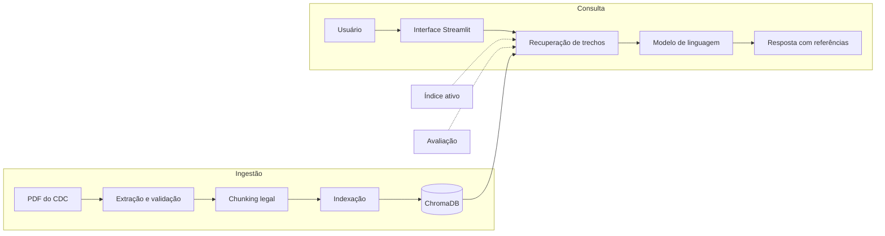
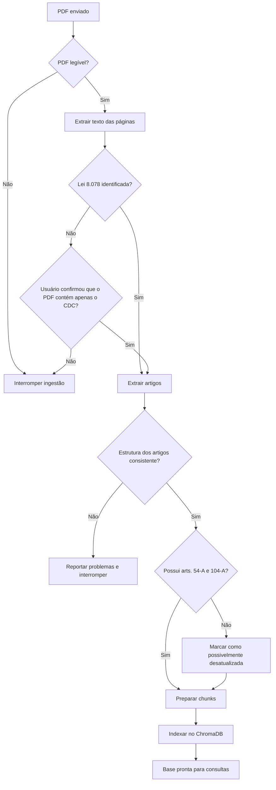
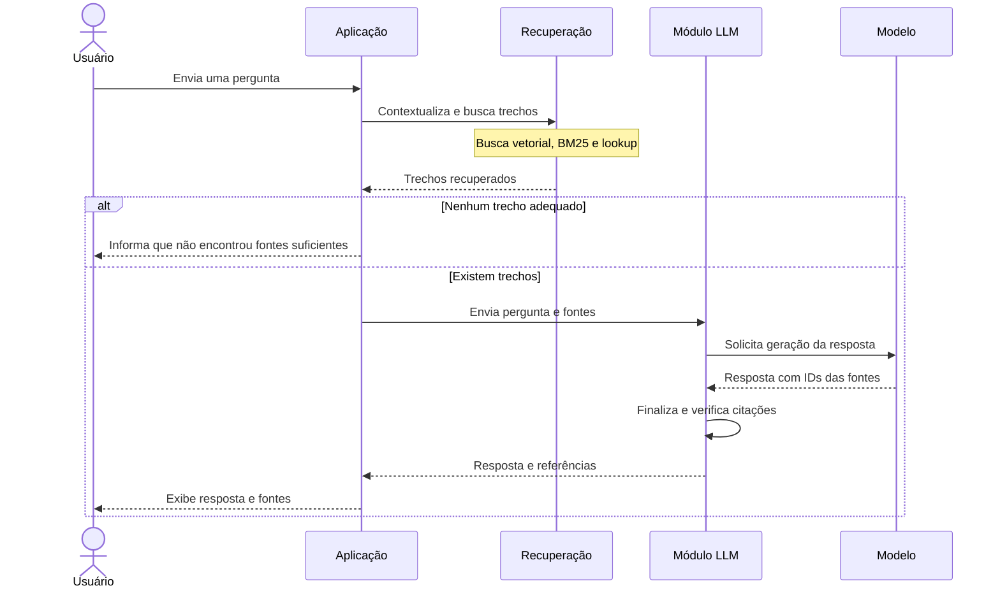
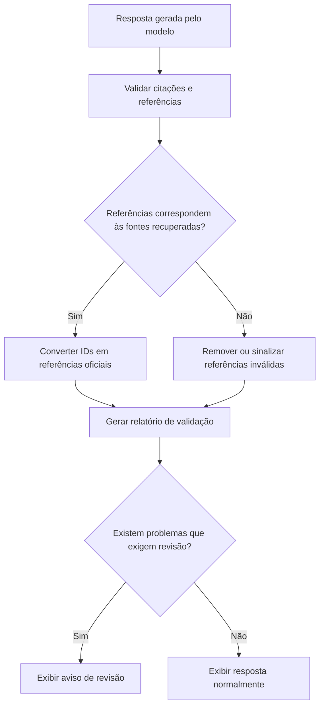

# Diagramas — CDC em Linguagem Simples

---

## 1. Visão geral da arquitetura

Apresenta os principais componentes do sistema, divididos entre ingestão da legislação, consulta e avaliação.

---

## 2. Pipeline de ingestão

Demonstra como o documento PDF é processado, validado e transformado em uma base de conhecimento para consultas.

---

## 3. Fluxo de uma pergunta

Apresenta o caminho percorrido por uma pergunta do usuário até a geração de uma resposta fundamentada nos trechos recuperados.

---

## 4. Verificação de citações

Demonstra como o sistema verifica as referências utilizadas pelo modelo antes de apresentar a resposta ao usuário.

---
